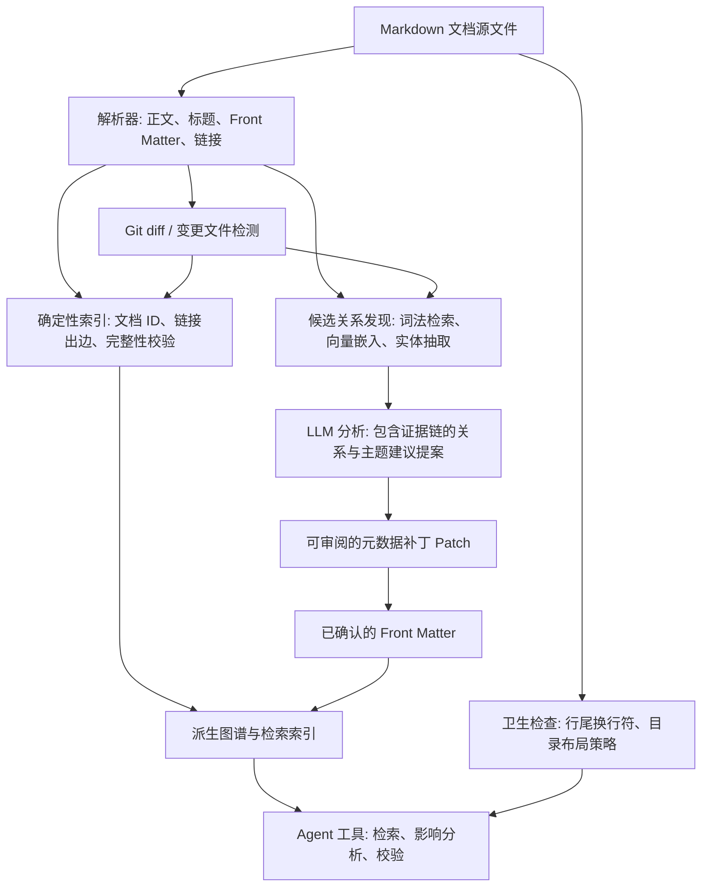

---
mdlineage:
  schema: 1
  id: docs.architecture
  kind: architecture
  status: active
  created_at: 2026-09-21
  updated_at: 2026-10-10
---

# 系统总体架构

## 概述

MDLineage 严格区分“仓库作者持久化的事实数据”与“系统运行时生成的派生索引”。Front Matter 元数据与正文中的 Markdown 超链接属于源数据；向量嵌入、反向引用表、模型推断关系以及主题摘要属于派生数据，可随时离线重建。

## 双层索引模型

### 仓库持久化层 (Repository layer)

仓库源文件中持久化保存：

- 全局稳定的文档逻辑 ID。
- 文档的类别（`kind`）、状态（`status`）、权威级别（`authority`）、主题标签（`topics`）与检索别名（`aliases`）。
- 经过人工或 Agent 确认的语义血缘关系（含非空 `reason` 说明与目标文档 `evidence` 定位锚点）。
- 正文中作者书写的物理 Markdown 超链接与目录链接。

这些事实数据完全透明、可直接在 Git 版本控制中审阅与追踪历史，即便派生索引尚未构建或不可用，也不会丢失核心事实。

### 内存派生层 (Derived layer)

本地或服务侧维护的派生索引包含：

- 解析后的标题大纲树与链接目标映射。
- 全局反向引用图谱（谁引用了我）与拓扑遍历结果；悬空引用另有按 raw 折叠键的存在性无关唤醒注册表（目标文件新建/删除时增量回灌引用方，键数上界 2×引用数，与解析器共用同一折叠）。
- 正文字节与章节内容的哈希指纹。
- 向量嵌入与词法倒排检索结构。
- 候选关系建议、证据文本片段、置信度分数以及分析模型元数据。
- 主题聚类结果、社区摘要与校验诊断集。

所有派生数据必须携带其源 Git 提交版本号或内容哈希，以精准识别过期数据。派生索引可通过仓库当前内容与配置文件随时全量重建。

## 关系来源分类

### 显式 Markdown 超链接

解析正文中的 Markdown 链接为确定性的 `links_to` 有向边。解析相对路径与标题锚点，并将目标文件映射至稳定的文档 ID。校验死链与缺失锚点，并在派生索引中生成反向引用表。

链接的存在仅表明作者创建了文档跳转导航，其本身并不等同于强依赖、逻辑矛盾或版本替代。

### 已确认的 Front Matter 语义关系

在文档头部 YAML 中显式声明的类型化关系（如 `depends_on`、`refines`、`supersedes`）属于权威语义事实。它们驱动影响面分析、成环校验（MDL305）、废弃拦截（MDL306）以及智能体协同。

### 旁路清单关系（零修改治理方案）

针对严禁修改正文或无法直接写入 Front Matter 的文档（例如符号链接引入的外部技能库、第三方文档包或只读治理目录），支持通过旁路清单文件（`manifestFile: mdlineage.manifest.yaml`）或内联配置声明元数据与血缘关系。

校验引擎在构建工作区索引（`WorkspaceIndex`）时，会将清单中的声明合并入内存中的 `DocEntry`。被清单覆盖的文档享受同等的一等公民能力：参与全局 ID 解析、循环依赖检测（MDL305）、废弃目标依赖拦截（MDL306）以及变更影响面分析，磁盘源文件保持逐字节零变动。

### 候选推断关系

候选关系发现结合词法检索、向量相似度、共享实体、标题层级与现有元数据。大语言模型对候选文档对进行语义分类并提取证据链。向量相似度仅作为召回信号，不直接持久化为关系类型。

在用户或 Agent 显式接受提议补丁之前，推断关系始终保持为派生状态。一份合规的提案需包含来源与目标 ID、关系类型、双向证据定位符与引用文本、置信度以及分析版本。

## 变更处理流程

当文档发生修改时：

1. 通过 Git 状态或文件系统监听事件，识别新增、修改、重命名及删除的 Markdown 文件。
2. 仅对受影响的文件执行增量重解析，比对稳定 ID、章节哈希、超链接与 Front Matter 变更。
3. 增量更新确定性拓扑边，清理失效引用的旧出边。
4. 将源自变更内容的候选推断关系标记为过期，仅触发受影响范围的定向分析刷新。
5. 基于已确认的强语义关系，重新计算反向引用集合与影响面波及范围（Blast Radius）。
6. 执行 Schema 结构、相对链接与图拓扑无环校验。
7. 可选地生成元数据更新补丁供人工或上层应用审阅。

主题聚类与全仓汇总分析以批处理任务按需运行，避免在高频单文档编辑时产生全量开销。

## 发现与保鲜排查漏斗（四阶段漏斗）

为审计大型知识库中的过时陈旧内容与断裂前置条件，MDLineage 避免线性逐篇通读，而是执行自顶向下的漏斗式排查管线，在数秒内将数百篇文档收敛至异常目标：

1. **第一阶段：机械规则与生命周期时钟过滤 (Mechanical rule and clock filtering)**
   运行 `mdlineage check .` 在毫秒级完成确定性静态校验：
   - 依赖前置断裂：`MDL302`（关系目标 ID 不存在）、`MDL306`（引用已废弃目标）、`MDL401`/`MDL403`（正文死链或不可移植路径）。
   - 生命周期衰减：`MDL801`（手动标注时间或 Git 提交时钟超出 `staleAfterDays` 阈值）、`MDL503`（目录意图例外授权过期）。
2. **第二阶段：图谱拓扑与波及范围遍历 (Graph topology and blast radius traversal)**
   在内存拓扑图 `WorkspaceIndex` 上进行有向无环图遍历：
   - 孤岛文档检测：标记入度与出度均为零的游离文档。
   - 上游波及影响分析：当基础架构文档被废弃或变更时，调用 `index.referrersOf(targetId)` 毫秒级锁定全量下游直接与间接影响方。
3. **第三阶段：环境实体与事实探针探测 (Fact entity and environment probing)**
   通过正则与 AST 提取正文硬编码的环境事实（工具版本号、物理文件路径、服务端口），执行只读本地探针（`which`、`--version`、`test -e`、`nc`），检测外部事实漂移，无需大模型上下文开销。
4. **第四阶段：定向深度语义审查 (Targeted semantic review)**
   仅针对前三阶段漏斗筛选出的极少数异常文档，交由开发者或大模型进行深入的逻辑概念通读与定向内容修正。

## 智能体工具接口

系统为 AI Agent 提供原子化的 MCP / 工具面接口，无需 Agent 自行编写图查询逻辑：

- `search_documents(query, filters)` — 搜索匹配的文档。
- `get_document(document_id)` — 获取指定 ID 的文档元数据与正文。
- `resolve_relation_target(id)` — 将逻辑 ID 反解为物理路径、标题大纲与引用者列表。
- `suggest_metadata(document_id, changed_sections)` — 基于诊断规则或模型分析生成元数据修改提案。
- `analyze_impact(document_id or diff)` — 提取指定文档变更带来的下游直接与间接波及范围。
- `validate_document(path, content?)` / `validate_repository(paths)` — 单文档或工作区静态校验。
- `apply_metadata_patch(proposal_id, write?)` — 显式接受并应用补丁提案。默认仅返回内存中的可审阅 diff，显式声明 `write: true` 时经过安全校验原子落盘。

读操作以精简结构返回文档路径与证据链；写操作保持显式确认，生成可供审查的代码差异。

## 可靠性与确定性边界

- 解析器与 JSON Schema 校验器提供 100% 确定性、离线可复现的刚性检查。
- 大模型输出具有概率性，必须附带原文证据链（Evidence）与置信度说明。
- 图谱遍历能精确解释已记录的拓扑依赖，但不假设全仓所有隐含关系均已被人工显式录入。
- 知识库覆盖度应借助基线评测集与仓库特化规则持续度量。
